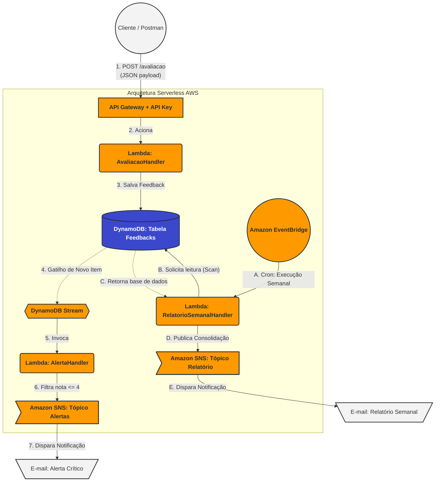

# Tech Challenge Fase 4 - Plataforma de Feedback Serverless ☁️

Este projeto é a entrega da Fase 4 da Pós-Graduação, focado em Cloud Computing, Serverless e Deploy de Aplicações. O sistema consiste em uma plataforma de processamento de feedbacks de alunos, totalmente hospedada na nuvem da AWS, garantindo alta disponibilidade, segurança e baixo custo operacional.

## 🏗️ Arquitetura da Solução e Modelo Cloud Escolhido

A solução foi desenhada utilizando o modelo **Serverless**, que se encaixa bem para cumprir os requisitos de negócio.
Temos um formulário de feedback com envio por demanda: a infraestrutura escala automaticamente para zero quando não há requisições, não gerando custos ociosos, e é capaz de absorver picos de acesso repentinos ao final das aulas.

### Componentes Envolvidos:

1. **Amazon API Gateway:** Atua como a porta de entrada da aplicação (endpoint POST `/avaliacao`), roteando e protegendo a requisição.
2. **AWS Lambda (Java 21):**
   - `ReceberAvaliacao`: Função acionada pelo API Gateway. Valida e persiste o feedback no banco.
   - `ProcessarFeedbackStream`: Função reativa acionada via DynamoDB Streams. Avalia a nota e dispara notificações para o SNS caso a nota seja igual ou inferior a 4 (urgência crítica).
   - `GerarRelatorioSemanal`: Função que realiza varredura no banco, agrupa métricas usando a *Stream API* do Java e envia o resumo semanal aos administradores.
3. **Amazon DynamoDB:** Banco de dados NoSQL para armazenar os feedbacks.
4. **Amazon SNS (Simple Notification Service):** Serviço de mensageria responsável por disparar os e-mails de alerta e os relatórios para os gestores.
5. **Amazon CloudWatch:** Serviço responsável pela centralização dos logs e monitoramento de saúde das Lambdas.

## 🔒 Segurança e Governança de Acesso

O ambiente em nuvem foi projetado seguindo as diretrizes do **AWS Well-Architected Framework**, com foco especial em segurança dos dados dos clientes e governança:

- **Princípio do Menor Privilégio (AWS IAM):** A governança de acesso foi implementada utilizando *IAM Roles* exclusivas para cada função. A Lambda de ingestão possui apenas permissão de escrita (`dynamodb:PutItem`), enquanto a Lambda de relatório possui apenas permissão de leitura (`dynamodb:Scan`), impedindo o acesso indevido ou alteração acidental dos dados.
- **Segurança em Repouso e em Trânsito:** Os dados sensíveis são armazenados no DynamoDB com criptografia nativa em repouso (*Encryption at Rest*). A comunicação externa é protegida por criptografia TLS via API Gateway.
- **Decisão Arquitetural (API Key vs. JWT):** Optou-se por não implementar validação de tokens JWT nativamente no API Gateway. Como os feedbacks são anônimos e este projeto atua como um microsserviço especialista em processamento assíncrono, acoplá-lo a um provedor de identidade (via *Lambda Authorizer* ou Cognito) adicionaria complexidade desnecessária e misturaria domínios de responsabilidade. Como premissa arquitetural (fora do escopo desta entrega), considerou-se que a autenticação do usuário e gestão do JWT seria tratada em um Sistema Core externo, e que teríamos um BFF (Backend For Frontend) realizando a ponte segura entre o front-end e a nossa API na AWS. 
- **Estratégia de Integração e Segurança (BFF):** Seguindo essa premissa, o modelo prevê que a API Serverless seja consumida exclusivamente por esse BFF. Ele atuaria como um proxy seguro: após validar a sessão do aluno, o BFF injetaria a API Key (x-api-key) na requisição para a AWS. Dessa forma, a credencial de acesso permanece protegida no servidor (Server-side), mantendo a nossa arquitetura Serverless coesa, enxuta e segura contra acessos anônimos não autorizados.

## 📊 Monitoramento e Observabilidade

A aplicação é 100% monitorada pelo **Amazon CloudWatch**.

- **Logs Centralizados:** Todas as execções das funções Lambda geram logs de execução automáticos nos *Log Groups* do CloudWatch, permitindo auditoria detalhada de cada invocação.
- **Métricas de Performance:** O console do CloudWatch acompanha as invocações, duração da execução e taxa de erros, garantindo a saúde do sistema.

## 🚀 CI/CD: Deploy Automatizado

A automação de entrega e atualização dos componentes (funções) foi construída utilizando o **GitHub Actions**. Toda vez que um novo código é aprovado e mergeado na branch `master`, a esteira é disparada executando as seguintes etapas:

1. Configuração do ambiente com Java 21 e Maven.
2. Build e empacotamento do artefato `.jar` de forma limpa.
3. Autenticação na AWS utilizando um usuário de serviço estritamente limitado.
4. Atualização automática do código (`UpdateFunctionCode`) das três funções Lambda ativas no ambiente Cloud.

## 💻 Tecnologias Utilizadas

- **Linguagem:** Java 21.
- **Cloud:** AWS (API Gateway, Lambda, DynamoDB, SNS, IAM, CloudWatch).
- **DevOps:** Git, GitHub Actions, AWS CLI.
- **Teste de API:** Postman.

## 📹 Vídeo de Demonstração

No vídeo abaixo, é possível conferir:

- A explicação da arquitetura e decisões de segurança (BFF/API Key).
- As configurações de governança no console da AWS (IAM).
- O funcionamento do pipeline CI/CD (GitHub Actions).
- Testes práticos no Postman demonstrando a gravação de dados, o envio do Alerta Crítico e a geração do Relatório Semanal.

🔗 **https://youtu.be/67J9s62dhCM**

## 👩‍💻 Autora

**Gabriela Fontainhas de Sordi** - rm372540